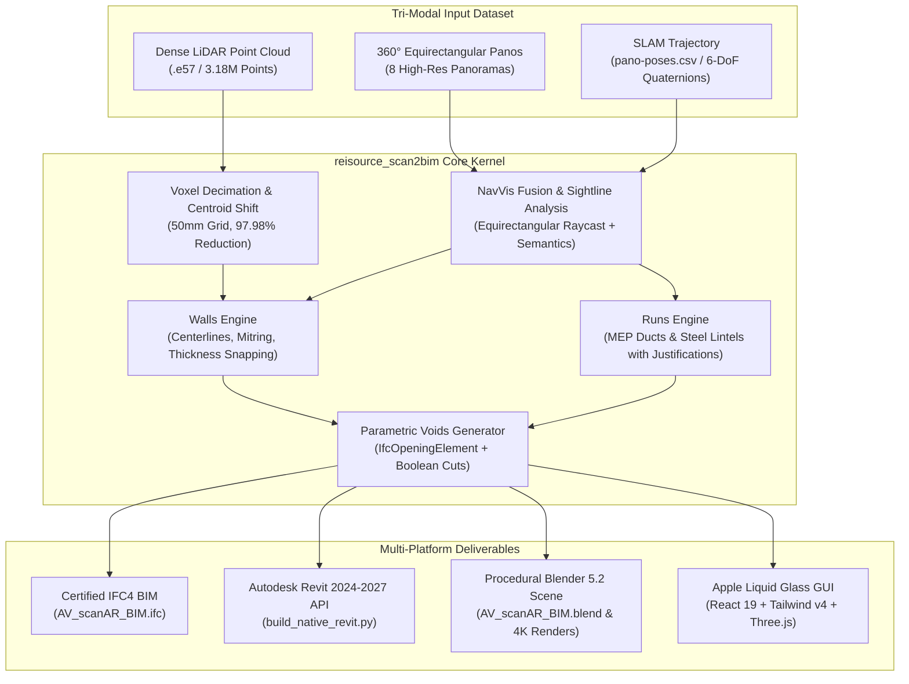

# reisource_scan2bim

> **Machine-First Scan-to-BIM Transformation Engine with Apple Glassmorphism GUI, Tri-Modal Sensor Fusion & Parametric Voids**

[](https://github.com/callen0817/reisource_scan2bim)
[]()
[]()
[]()

---

## 1. Overview

`reisource_scan2bim` is an advanced automated Scan-to-BIM pipeline that turns dense LiDAR point clouds (`.e57`, `.las`, `.laz`, `.ply`), **360° equirectangular panoramas**, and **mobile SLAM trajectories** (e.g., NavVis VLX-3) into fully authentic, high-LOD architectural BIM models ready for **Autodesk Revit 2024–2027**, **certified IFC4**, and **Blender 5.2**.

Inspired by cutting-edge architectural AI research:
1. **Spectral Labs Quartz**: Machine-first CAD kernel with graph topology, boundary-representation constraint enforcement, and differentiable geometric reasoning.
2. **BIMCraft**: Analytical wall centerlines with parametric corner mitring, true `IfcOpeningElement` boolean void cuts (`IfcRelVoidsElement`), and linear MEP/structural runs (`IfcDuctSegment`, `IfcBeam`).
3. **Skills-for-Architects / CSI MasterFormat**: Parametric architectural catalog dimensions ($4\text{--}7/8''$, $6\text{--}1/8''$ interior, $12''$ exterior walls, rough opening clearances).

---

## 2. Tri-Modal Ingestion Pipeline



---

## 3. Key Architectural Innovations

### 1. Parametric Wall Opening Voids (The BIMCraft / IFC4 Standard)
Traditional scan-to-mesh converters produce box placeholders that overlap solid walls. `reisource_scan2bim` generates native IFC4 architectural voids:
- Creates `IfcOpeningElement` matching the rough opening dimensions.
- Links opening to the host wall via `IfcRelVoidsElement`, executing a true physical boolean cut through the wall geometry.
- Inserts `IfcDoor` or `IfcWindow` into the void and binds them via `IfcRelFillsElement`.

### 2. Linear MEP & Structural Framing Justifications
Implements `runs_engine.py` for linear building infrastructure:
- **Beams & Lintels**: `IfcBeam` with `top` justification flush with ceiling slabs.
- **Ducts & Slot Diffusers**: `IfcDuctSegment` with `center` justification aligned to mechanical distribution lines.

### 3. Apple "Liquid Glass" Desktop UI
- Translucent frosted glass panels (`backdrop-filter: blur(24px)`), smooth drag-and-drop file ingestion, dynamic LOD slider, and real-time conversion terminal log.
- Hoverable tooltips explaining multi-dataset formats and NavVis epoch timestamps.

---

## 4. Repository Structure

```text
reisource_scan2bim/
├── core/
│   ├── __init__.py
│   ├── navvis_unifier.py       # Multi-dataset NavVis unifier (4x4 rigid alignment)
│   ├── spatial_extractor.py    # Statistical elevation, RANSAC wall fitting & slices
│   ├── walls_engine.py         # Analytical centerlines, mitring & catalog snapping
│   ├── runs_engine.py          # Linear MEP runs (ducts) & structural beams
│   ├── navvis_fusion.py        # 360° equirectangular raycasting & visual sightlines
│   └── bim_exporter.py         # IFC4 & Revit semantic manifest engine
├── gui/                        # Apple "Liquid Glass" GUI (React, Tailwind v4, Vite)
│   ├── src/
│   │   ├── App.jsx             # Translucent UI shell & drag-and-drop
│   │   ├── main.jsx
│   │   └── index.css           # Glassmorphism utilities & SF Pro typography
│   ├── package.json
│   └── vite.config.js
├── scripts/
│   ├── export_ifc.py           # Native IFC4 exporter with IfcOpeningElement voids
│   ├── build_revit.py          # Autodesk Revit 2024-2027 automation script
│   └── build_blender.py        # Procedural Blender 5.2 BIM scene builder & renderer
├── README.md
└── .gitignore
```

---

## 5. Quickstart

### 1. Exporting Native IFC4
```bash
python scripts/export_ifc.py --manifest path/to/bim_manifest.json --out output.ifc
```

### 2. Building in Autodesk Revit 2024–2027
Open Revit and run `scripts/build_revit.py` in **pyRevit**, **Revit Python Shell**, or a **Dynamo Python Node** to instantiate native architectural walls, floors, ceilings, hosted doors, windows, and linear MEP runs.

### 3. Building in Blender 5.2
```bash
blender-launcher.exe --background --python scripts/build_blender.py -- --manifest path/to/bim_manifest.json --out output.blend
```

### 4. Running the Apple "Liquid Glass" GUI
```bash
cd gui
npm install
npm run dev
```
Open [http://localhost:3000](http://localhost:3000) to experience the interface.

---

## 6. License
MIT License • Engineered for Scan-to-BIM Automation.
